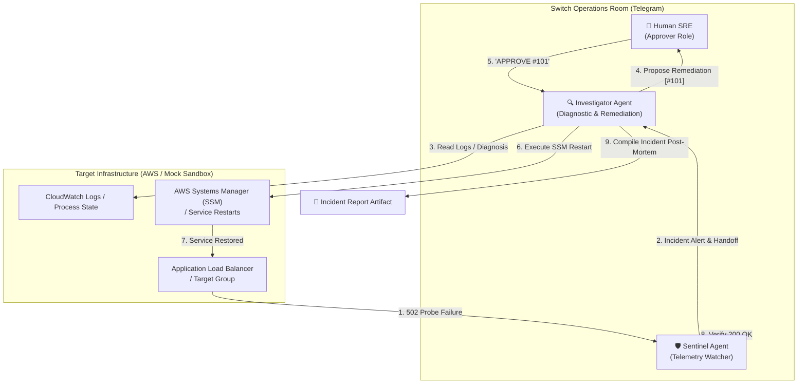

# OpsRoom: Collaborative Multi-Agent AWS Incident Response with Switch & Antigravity

[](LICENSE)
[](https://nodejs.org)

> **OpsRoom** transforms your team's chat application (Telegram / Slack) into a collaborative incident response war-room. Infrastructure monitoring agents (**Sentinel**) and incident resolution agents (**Investigator**) work alongside human engineers to detect AWS outages, diagnose root causes, and safely execute approved remediation.

## 📺 Demo Video

[](https://youtu.be/1SA2d8gol98)

**Title:** OpsRoom Demo – Collaborative AWS Incident Response with Switch

**Description:** This video showcases a mock sandbox simulation of OpsRoom, demonstrating how agents Sentinel and Investigator collaborate in a Switch chat room to detect and remediate a simulated AWS ALB failure. The demo uses mock AWS resources; the live mode requires proper AWS credentials and IAM permissions.
## 🏆 Project Overview

- **Track:** Best Business Workflow
- **Platform:** Switch + Telegram + Antigravity
- **Core Problem:** On-call engineer alert fatigue, manual AWS console context switching, and the safety risks of unmonitored autonomous AI agents.
- **The Solution:** Governed multi-agent collaboration inside a Switch chat room with strict human-in-the-loop authorization boundaries.



---

## 🔑 Why Switch is Central to OpsRoom

OpsRoom cannot function as a simple standalone Telegram bot or webhook:

1. **Multi-Agent Separation of Concerns:**
   - **Sentinel** operates under `addressing: anyone` with read-only monitoring tools.
   - **Investigator** operates under `addressing: owner-agents` and diagnostic/remediation tools.
2. **Room Instructions & Memory:**
   - Operational policies, incident handoff conventions, and authorization gates live in Switch's room state, shared seamlessly between all participants.
3. **Addressing & Permission Gates:**
   - Switch restricts who can prompt each agent. Mutating actions are strictly quarantined behind human verification tokens.
4. **Declarative Reproducibility:**
   - The entire team, its permissions, and its room instructions are defined declaratively in `switch/opsroom.template.yaml`.

---

## 🚀 60-Second Clean-Room Quickstart

OpsRoom includes a built‑in **Dual‑Mode Engine**:

* **Mock mode** (`MOCK_AWS=true` – default) runs a local Express server, costing nothing.
* **Live mode** (`MOCK_AWS=false`) monitors a real AWS ALB using the ARN you set in `.env`.

Toggle the flag in your `.env` file to switch between the two.

### 1. Clone & Install
```bash
git clone https://github.com/mrtuxcoder/OpsRoom.git
cd OpsRoom
npm install
```

### 2. Configure Environment
Copy the example and fill in required values:
```bash
cp .env.example .env
# Edit .env with your values (TELEGRAM_BOT_TOKEN, TELEGRAM_CHAT_ID, AWS_ALB_TARGET_GROUP_ARN, MOCK_AWS)
```

### 3. Run the Full Incident Lifecycle Test
In one terminal, start the target service:
```bash
npm run start:mock
```

In a second terminal, execute the end-to-end incident response flow:
```bash
make test-flow
```

You will see:
1. Sentinel verifies initial target health (`200 OK`).
2. Chaos script injects a worker deadlock (`502 Bad Gateway`).
3. Sentinel detects target group failure and alerts the room.
4. Investigator retrieves logs and isolates the `SIGABRT` root cause.
5. Human authorization token (`APPROVE #101`) gates execution.
6. Remediation restarts the service.
7. Sentinel verifies recovery (`200 OK`, `42ms` latency).
8. Investigator compiles the post-mortem report in `artifacts/`.

### 4. Proactive Monitoring Watcher (Optional)
To run Sentinel as an autonomous continuous watchdog daemon:
```bash
make watch    # checks target health every 5s and triggers instant alert on 502
```

---

## 🔐 AWS Permissions & Least-Privilege IAM Policy

> [!IMPORTANT]
> **Never use AWS root account keys or full AdministratorAccess.** OpsRoom adheres strictly to the **Principle of Least Privilege (PoLP)**. The bot requires access only to the specific Target Group, Log Group, and EC2 instance being managed.

### What the Bot Demands (Live AWS Mode)

When running in live mode (`MOCK_AWS=false`), OpsRoom uses exactly **3 AWS SDK operations** across its toolchain:

| Agent / Tool | AWS Action | Permission Type | Purpose | Resource Scope |
| :--- | :--- | :--- | :--- | :--- |
| **Sentinel** (`check-health.js`) | `elasticloadbalancing:DescribeTargetHealth` | Read-Only | Queries ALB Target Group to check healthy/unhealthy container endpoints | Target Group ARN |
| **Investigator** (`inspect-logs.js`) | `logs:FilterLogEvents` | Read-Only | Queries recent crash stack traces, OOM, and 502 errors | CloudWatch Log Group ARN |
| **Investigator** (`run-remediation.js`) | `ssm:SendCommand` | Mutating (Gated) | Dispatches `AWS-RunShellScript` to restart the failing container/systemd service | EC2 Instance ARN & SSM Document |

### Minimal IAM Policy JSON

Attach the following minimal policy to your IAM User or Service Account. Replace `<AWS_ACCOUNT_ID>`, `<REGION>`, `<TARGET_GROUP_NAME>`, `<LOG_GROUP_NAME>`, and `<EC2_INSTANCE_ID>` with your specific resource values:

```json
{
  "Version": "2012-10-17",
  "Statement": [
    {
      "Sid": "OpsRoomAlbHealthCheck",
      "Effect": "Allow",
      "Action": [
        "elasticloadbalancing:DescribeTargetHealth"
      ],
      "Resource": "arn:aws:elasticloadbalancing:<REGION>:<AWS_ACCOUNT_ID>:targetgroup/<TARGET_GROUP_NAME>/*"
    },
    {
      "Sid": "OpsRoomCloudWatchLogInspection",
      "Effect": "Allow",
      "Action": [
        "logs:FilterLogEvents"
      ],
      "Resource": "arn:aws:logs:<REGION>:<AWS_ACCOUNT_ID>:log-group:<LOG_GROUP_NAME>:*"
    },
    {
      "Sid": "OpsRoomSsmRemediation",
      "Effect": "Allow",
      "Action": [
        "ssm:SendCommand"
      ],
      "Resource": [
        "arn:aws:ec2:<REGION>:<AWS_ACCOUNT_ID>:instance/<EC2_INSTANCE_ID>",
        "arn:aws:ssm:<REGION>::document/AWS-RunShellScript"
      ]
    }
  ]
}
```

### Static Access Keys vs. IAM Role

* **Why Static Credentials (`AWS_ACCESS_KEY_ID` / `AWS_SECRET_ACCESS_KEY`):**  
  In local development, hackathon evaluations, or external war-room orchestrators running outside AWS (e.g., local workstation, external CI/CD, or non-AWS hosted bot), AWS static access keys provide immediate, environment-agnostic connectivity without requiring AWS VPC peering or direct instance attachment.
* **Production Deployment via IAM Role:**  
  If you deploy OpsRoom inside AWS (e.g., on an EC2 instance, ECS task, or EKS pod with IRSA), **leave `AWS_ACCESS_KEY_ID` and `AWS_SECRET_ACCESS_KEY` blank** in `.env`. The AWS SDK v3 will automatically resolve ambient credentials from the instance profile or task execution role using the IAM policy above.

---


## 🛠️ Repository Structure

```
.
├── Makefile                     # 1-command targets: install, demo, chaos, test-flow
├── package.json                 # Node.js ESM configuration
├── .env.example                 # Environment variables (AWS & Mock parameters)
├── switch/
│   ├── opsroom.template.yaml   # Canonical Switch template for Console instantiation
│   └── room-instructions.md    # Ground-truth room instructions & approval protocol
├── agents/
│   ├── sentinel/
│   │   └── instructions.md     # Sentinel monitoring agent prompt & addressing
│   └── investigator/
│       └── instructions.md     # Investigator diagnostic agent prompt & gate logic
├── src/
│   ├── mock/
│   │   ├── server.js           # Express mock target simulating ALB/EC2/Logs/SSM
│   │   └── chaos.js            # CLI script to inject 502/crashes on demand
│   └── tools/
│       ├── check-health.js     # Health probe tool (Sentinel)
│       ├── inspect-logs.js     # Log inspection tool (Investigator)
│       ├── run-remediation.js  # Human-gated SSM restart tool (Investigator)
│       └── generate-report.js  # Incident post-mortem generator
└── artifacts/                  # Generated incident post-mortem markdown artifacts
```

---

## 🔒 Security & Approval Gate Protocol

Investigator will refuse to run remediation if called without an explicit authorization token:

```bash
# Attempting execution without token (BLOCKED):
$ node src/tools/run-remediation.js
# => Output: "SECURITY GATE: Missing required approval token (--token <TOKEN>)"

# Authorized execution with token:
$ node src/tools/run-remediation.js --token 101 --action restart
# => Output: "SUCCESS: Service guidra-production restarted successfully"
```

---

## 📄 License
Apache-2.0
