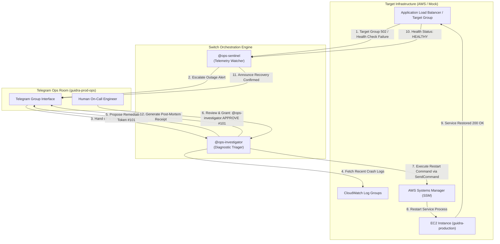

# OpsRoom Architecture & Incident Response Protocol

OpsRoom is an autonomous, human-governed multi-agent incident response team built for cloud infrastructures (AWS ALB, CloudWatch, SSM) and coordinated through **Switch** and **Telegram**.



---

## 1. Core Design Principles

### Principle 1: Least Privilege & Zero Root Keys for AI
Agents are strictly decoupled from unrestricted infrastructure access:
- **`ops-sentinel`** is strictly **Read-Only**. It has permissions to inspect target group health and CloudWatch telemetry. It possesses zero mutation credentials.
- **`ops-investigator`** can prepare diagnosis and write remediation proposals, but its execution tool (`run-remediation.js`) will **abort immediately with an error** if an approved cryptographic or sequential token (`#101`) issued by a designated human operator is missing.

### Principle 2: Chat-First Multi-Agent Collaboration
Instead of an isolated web dashboard that on-call engineers must remember to open, incident response takes place directly in **Telegram** through the **Switch** bridge. Both agents and human engineers share the same communication channel:
- Sentinel acts as the early warning radar.
- Investigator acts as the forensic triager.
- The human acts as the ultimate authorization authority.

### Principle 3: Deterministic Receipts (Post-Mortem Artifacts)
Every resolved incident concludes with an automatically generated Markdown post-mortem document stored under `artifacts/incident-<timestamp>.md` recording:
1. Root cause analysis
2. Critical log traces
3. Remediation action taken and authorizing user token
4. Time to resolution (MTTR)

---

## 2. Dual-Mode Engine Architecture

OpsRoom operates in two interchangeable modes controlled by `MOCK_AWS`:

| Feature | Mock Sandbox (`MOCK_AWS=true`) | Live AWS (`MOCK_AWS=false`) |
| :--- | :--- | :--- |
| **Target Probe** | Local Express HTTP endpoint (`:8080/health`) | `@aws-sdk/client-elastic-load-balancing-v2` (`DescribeTargetHealth`) |
| **Log Extraction** | Local in-memory chaos log history | `@aws-sdk/client-cloudwatch-logs` (`FilterLogEvents`) |
| **Remediation** | Local process restart endpoint | `@aws-sdk/client-ssm` (`SendCommand` - `AWS-RunShellScript`) |
| **Cost & Friction** | $0.00, instant 60-second setup, zero AWS bills | Real production AWS cloud environment |

---

## 3. Directory Layout

```
OpsRoom/
├── agents/                       # Switch Agent Definitions
│   ├── sentinel/instructions.md  # Telemetry watcher instructions
│   └── investigator/instructions.md # Diagnostic triager instructions
├── artifacts/                    # Auto-generated incident post-mortems
├── docs/                         # Technical architecture & specs
│   └── ARCHITECTURE.md
├── switch/                       # Switch room orchestration template
│   ├── opsroom.template.yaml     # Room and agent topology
│   └── room-instructions.md
├── src/
│   ├── aws/                      # Production AWS SDK v3 modules
│   │   ├── alb.js                # ELBv2 target health checker
│   │   ├── logs.js               # CloudWatch logs filter & root-cause triager
│   │   └── ssm.js                # SSM run command executor
│   ├── mock/                     # Zero-friction test sandbox
│   │   ├── server.js             # Mock production service & target group
│   │   └── chaos.js              # Injectable chaos triggers (crash/recover)
│   └── tools/                    # Dual-mode CLI tools invoked by agents
│       ├── check-health.js
│       ├── inspect-logs.js
│       ├── run-remediation.js
│       ├── generate-report.js
│       └── sentinel-watch.js     # Autonomous background watchdog daemon
├── Dockerfile                    # Container definition
├── docker-compose.yml            # Multi-container orchestration
├── Makefile                      # Automated lifecycle commands (`make test-flow`)
└── package.json
```
