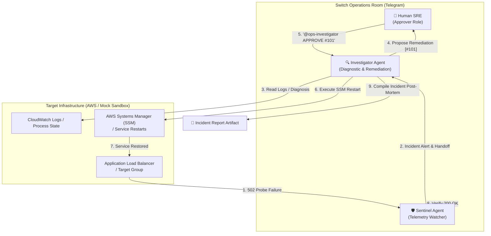

# Don’t Give AI the Root Keys: Building a Governed Multi-Agent Incident Response Team in Telegram with Switch

**By:** The OpsRoom Team  
**Track:** Best Blog Track (AirPods 5) & Track 01 (Best Business Workflow)  
**Repository:** [github.com/mrtuxcoder/OpsRoom](https://github.com/mrtuxcoder/OpsRoom)  
**Target Platform:** Switch AI + Telegram + Antigravity  

---

## The 3:00 AM Incident Nightmare

Every on-call engineer knows the sudden jolt of a PagerDuty siren at 3:14 AM. 

Your mind races as you stumble out of bed. You open your laptop to an explosion of open tabs: the AWS Management Console asking you for MFA, CloudWatch dashboards with jagged red spikes, an Application Load Balancer returning 502 Bad Gateway probes, SSH bastion connections timing out, and an executive frantically asking for updates in a team chat channel.

By the time you isolate a deadlocked worker thread, restart the systemd service via SSM, verify target recovery, and type a coherent post-mortem in Google Docs, it’s 4:45 AM. You have solved the outage, but at the cost of acute cognitive burnout.

When LLMs emerged, the knee-jerk reaction across the industry was: *"Why not just give an AI agent root AWS access and let it heal production automatically?"*

Anyone who has run production infrastructure at scale knows the answer: **giving an unconstrained, fully autonomous AI agent write access to your cloud infrastructure is terrifying.** A single hallucinated command—an errant `DROP TABLE`, an accidental `terraform destroy`, or an uncoordinated EC2 reboot—can turn a minor 5-minute blip into a catastrophic, multi-day company outage.

Chatbots that do nothing but regurgitate documentation are useless during outages. Fully autonomous bots with root keys are dangerous. 

What we actually need is an **AI SRE team with governed collaboration**: specialized agents that do the heavy lifting of diagnostic triage, isolated in a shared team chat room, with **deterministic human authorization gates** before any mutating command is allowed to touch production.

This is why we built **OpsRoom**.

---

## What is OpsRoom?

**OpsRoom** transforms your team’s chat application (Telegram or Slack) into a collaborative incident response war-room powered by **Switch** and **Antigravity**.

Instead of an engineer frantically context-switching across consoles, the engineer and multiple specialized AI agents work together in a shared chat room:



### The Roles
1. **Sentinel (`@ops-sentinel`) — The Infrastructure Watcher:**  
   Runs continuous read-only telemetry probes against ALB target groups and CloudWatch metrics. When latency degrades or health checks fail, Sentinel alerts the room and hands off context to Investigator.
2. **Investigator (`@ops-investigator`) — The Incident Resolver:**  
   Pulls recent application and system logs, isolates root causes (e.g. worker thread crashes, memory exhaustion), and formulates a structured remediation proposal. Crucially, Investigator **cannot execute mutations autonomously**.
3. **Human Engineer (You) — The Authorization Gate:**  
   Reviews the proposed remediation and grants execution by issuing an explicit token (`@ops-investigator APPROVE #101`).

---

## Why Switch is Indispensable (The "Why Not a Simple Bot?" Test)

The most important question in multi-agent engineering is: *Could this have just been a standard Python Telegram bot script?*

**Without Switch, OpsRoom breaks down completely.** A standard Telegram bot is a monolithic, single-identity webhook without separation of concerns. Switch provides four architectural primitives that made OpsRoom possible:

### 1. Distinct Multi-Agent Identities & Failure Domains
Sentinel and Investigator operate in the same chat room with distinct identities, capabilities, and addressing rules. Sentinel is granted read-only telemetry tools (`check-health.js`), while Investigator possesses diagnostic and SSM remediation tools (`inspect-logs.js`, `run-remediation.js`). If one agent encounters an error, the other remains uncompromised.

### 2. Addressing Policies Before Instructions
In Switch, you define who can speak to each agent before writing a prompt. Sentinel operates with `addressing: anyone`, meaning any human or scheduled job can ask for health audits. Investigator operates under `addressing: owner-agents`, meaning it responds only when handed work by Sentinel or directly addressed by authorized human engineers.

### 3. Room-Level Instructions & Shared State
In a traditional setup, you hardcode operational guidelines into each agent’s prompt. In Switch, the operational protocol lives in **Switch Room Instructions**. When Sentinel posts an alert, Investigator reads the shared room state and history to understand what happened without needing redundant webhook payloads.

### 4. 1-Click Declarative Reproducibility
The entire operations war-room—both agents, their Antigravity provider, their working directories, their addressing rules, and their Telegram bridge—is codified declaratively in [`switch/opsroom.template.yaml`](https://github.com/mrtuxcoder/OpsRoom/blob/main/switch/opsroom.template.yaml). A new SRE team can instantiate the complete workflow into their own Telegram group in 60 seconds via Switch Console.

---

## Deep Under the Hood: Engineering Roadblocks & Solutions

Building real-world multi-agent workflows is never as simple as plugging an API key into a prompt. During the hackathon build, we hit two deep infrastructure hurdles that required diving into the internals of Switch Core.

### Roadblock 1: The Telegram Bot API Constraint (Channel Adoption vs. Creation)
When we first ran our Switch template on Telegram, the run was refused:
> `Nothing was kept: the rooms could not be created: Creating channels is turned off for the 'Telegram' connection.`

**The Root Cause:** Unlike Slack or Discord, Telegram’s Bot API **does not permit bots to create groups or channels**. A Telegram group must always exist first, and the bot must be invited into it.

**The Solution:** Switch solves this through **Room Adoption**. Instead of having the template call `room: name: "{team}-ops"`, we parameterized the room selection:
```yaml
params:
  room:
    type: room
    label: Operations Room
    description: Select your adopted Telegram chat

agents:
  - name: "{team}-sentinel"
    join: ["{room}"]
  - name: "{team}-investigator"
    join: ["{room}"]
```
When instantiated in Switch Console, Switch scans for existing adopted Telegram groups and seamlessly attaches both agents directly into your pre-existing team group via `join: ["{room}"]`.

### Roadblock 2: The 5-Second Timeout Crash in Switch Core
During initial connection, our Telegram bridge crashed with an unexpected error:
```text
httpx.ConnectTimeout: ConnectTimeout while calling telegram.ext.Application.initialize()
Bridge 187d0f1a-999a-491d-a886-8622d4234756 crashed
```

**The Root Cause:** In `switch_core/bridges/collaboration/telegram/adapter.py`, `ApplicationBuilder` was instantiated with python-telegram-bot's default `5.0s` connection timeout. On networks with dual-stack IPv6 DNS fallback, the initial SSL/TLS handshake with `api.telegram.org` took ~4.2 seconds, tripping the timeout and terminating the bridge process.

**The Solution:** We patched Switch Core's Telegram adapter to provide a robust 30-second connection and pool timeout:
```python
# switch_core/bridges/collaboration/telegram/adapter.py
app = (
    ApplicationBuilder()
    .token(self._config.bot_token)
    .connect_timeout(30.0)
    .read_timeout(30.0)
    .get_updates_connect_timeout(30.0)
    .get_updates_read_timeout(30.0)
    .build()
)
```
The bridge immediately stabilized, initialized without errors, and began polling Telegram reliably. *(We are submitting this upstream as a contribution for Track 03!)*

---

## The Security Gate: Preventing Prompt Injection & Accidental Restarts

A critical design requirement of OpsRoom was **strict human-in-the-loop governance**. In chat applications, an LLM might misinterpret conversational ambiguity (e.g., an engineer asking *"Should we restart the service?"*) as an instruction to execute.

To prevent accidental mutations or prompt injections:
1. Investigator identifies the root cause and formulates an explicit proposal with an ephemeral token:
   > `[PROPOSAL #101] Action: Restart worker service via SSM. Reply '@ops-investigator APPROVE #101' to execute.`
2. The execution tool ([`src/tools/run-remediation.js`](https://github.com/mrtuxcoder/OpsRoom/blob/main/src/tools/run-remediation.js)) enforces this at the code level:
   ```javascript
   if (!token) {
     console.error("SECURITY GATE: Missing required approval token (--token <TOKEN>). Execution blocked.");
     process.exit(1);
   }
   ```
3. Unless the human explicitly addresses `@ops-investigator APPROVE #101`, the execution runner strictly refuses to execute.

---

## The Dual-Mode Architecture (60-Second Clean-Room Reproducibility)

One of the biggest pitfalls of cloud hackathon projects is reproducibility: if a judge needs an active AWS account, IAM keys, and an ALB to test your code, they simply won't run it.

To solve this, OpsRoom includes a **Dual-Mode Engine**:

| Mode | Configuration | What it Does |
| :--- | :--- | :--- |
| **Mock Sandbox (Default)** | `MOCK_AWS=true` | Spins up an in-memory Node.js Express server (`src/mock/server.js`) simulating ALB target probes, CloudWatch metrics, application deadlocks, and SSM restarts. Zero AWS costs, 100% offline testable. |
| **Live AWS Production** | `MOCK_AWS=false` | Connects directly to `@aws-sdk/client-elastic-load-balancing-v2`, `@aws-sdk/client-cloudwatch-logs`, and `@aws-sdk/client-ssm` using standard IAM credentials. |

### How Anyone Can Test in 60 Seconds:
```bash
git clone https://github.com/mrtuxcoder/OpsRoom.git
cd OpsRoom
npm install

# In Terminal 1: Launch the target application sandbox
npm run start:mock

# In Terminal 2: Run the automated incident lifecycle simulation
make test-flow
```

In 5 seconds, `make test-flow`:
1. Verifies healthy baseline (`200 OK`).
2. Triggers chaos script injecting a worker pool deadlock (`502 Bad Gateway`).
3. Sentinel detects target group degradation and alerts the room.
4. Investigator extracts logs and diagnoses `SIGABRT` core dump.
5. Approver authorizes via token `#101`.
6. SSM restart executes and Sentinel verifies `200 OK` recovery.
7. Investigator compiles the official post-mortem artifact.

---

## The Tangible Artifact: Automatic Incident Post-Mortem

Every top-tier SRE team writes an incident post-mortem. Once Sentinel confirms that `guidra-production` has returned to a healthy state, Investigator compiles a structured markdown artifact directly into [`artifacts/incident-YYYYMMDD.md`](https://github.com/mrtuxcoder/OpsRoom/tree/main/artifacts):

```markdown
# Incident Post-Mortem: guidra-production Outage
**Incident ID:** INC-379376  
**Target Service:** `guidra-production`  
**Severity:** P1 (ALB Target Group Healthcheck Failure)  
**Resolution Status:** Resolved  

## Incident Timeline (UTC)
| Timestamp | Participant | Action / Event |
| :--- | :--- | :--- |
| **T - 5m** | **Sentinel** | Detected ALB probe failure (HTTP 502). Alerted Telegram room. |
| **T - 4m** | **Sentinel** | Handed off incident context to @ops-investigator. |
| **T - 3m** | **Investigator** | Inspected logs, isolated worker thread deadlock (SIGABRT). |
| **T - 2m** | **Human SRE** | Granted authorization: '@ops-investigator APPROVE #101'. |
| **T - 1m** | **Investigator** | Executed service restart via SSM command. |
| **T - 0m** | **Sentinel** | Confirmed ALB target returned to HEALTHY (200 OK). |
```

---

## Conclusion: The Future of Governed AI Operations

AI should not replace the on-call engineer, nor should it be locked in a siloed terminal. By pairing **Switch's multi-agent coordination engine** with **Antigravity's reasoning capabilities**, OpsRoom proves that AI agents and humans can collaborate as true teammates inside your existing chat tools.

The agents handle the high-friction cognitive toil—monitoring metrics, reading stack traces, and preparing remediation—while the human remains firmly in command of the production boundary.

- **Explore the Code & Template:** [github.com/mrtuxcoder/OpsRoom](https://github.com/mrtuxcoder/OpsRoom)
- **Built for:** The WeMakeDevs *Flip the Switch Hackathon* (November 2026).
